<div align="center">

<a href="https://getclientos.com/demo?utm_source=github&utm_medium=referral&utm_campaign=clientos_launch&utm_content=readme_banner">
  
</a>

<h1>ClientOS: the self-hosted client portal your agency owns</h1>

<p><b>Sell, get paid, deliver and invoice from one portal, under your brand, on your own server.</b><br>
One-time license. No monthly fee, no per-seat pricing, no cut of your payments.</p>

<p>
  <a href="https://getclientos.com/demo?utm_source=github&utm_medium=referral&utm_campaign=clientos_launch&utm_content=readme_hero"></a>
  <a href="https://huelab-byte.github.io/tryclientos/"></a>
  <a href="https://getclientos.com/docs?utm_source=github&utm_medium=referral&utm_campaign=clientos_launch&utm_content=readme_hero"></a>
</p>

<p>
  
  
  
  
  
  <a href="LICENSE"></a>
</p>

<p>
  <a href="#-see-it-in-action">Tour</a> ·
  <a href="#-how-it-works">How it works</a> ·
  <a href="#-everything-in-the-box">Features</a> ·
  <a href="#-your-data-stays-on-your-server">Data</a> ·
  <a href="#-install-in-one-command">Install</a> ·
  <a href="#-pricing-pay-once-own-it">Pricing</a> ·
  <a href="#-clientos-vs-hosted-portals">Compare</a> ·
  <a href="#-faq">FAQ</a> ·
  <a href="#-free-agency-resources-in-this-repo">Free resources</a>
</p>

</div>

<br>

<div align="center">
  
  <sub>The ClientOS showreel. The full product, with sample data, is one click away in the <a href="https://getclientos.com/demo?utm_source=github&utm_medium=referral&utm_campaign=clientos_launch&utm_content=readme_showreel">instant demo</a>.</sub>
</div>

<br>

> [!NOTE]
> **This repository is maintained by the ClientOS team, and ClientOS is our own product.** Every claim
> below comes from [getclientos.com](https://getclientos.com) or its docs and is sourced line by line in
> [AUDIT.md](AUDIT.md). Anything we could not verify is in [UNVERIFIED.md](UNVERIFIED.md) and is not
> claimed. See the [full disclosure](#-disclosure).

## ✦ Why agencies choose ClientOS

<table>
<tr>
<td width="33%" valign="top">

### 🖥️ Your server
Clients, orders, messages, invoices and files sit in **your own PostgreSQL database** on a Linux VPS you
rent and control. A license check-in is the only thing that leaves it.

</td>
<td width="33%" valign="top">

### 🎨 Your brand
Your domain, five logo slots and two brand colours that repaint the portal, admin, sign-in, emails and
invoices. **Clients never see the ClientOS name.**

</td>
<td width="33%" valign="top">

### 💳 Pay once
**One license per domain, paid once.** Unlimited clients, staff and orders. Your only running cost is
the server, from about **$10 a month**.

</td>
</tr>
</table>

### By the numbers

<table>
<tr>
<td align="center" width="16%"><h2>122</h2><sub>staff permissions,<br>grouped into roles you build</sub></td>
<td align="center" width="16%"><h2>76</h2><sub>notification types,<br>in-app and email</sub></td>
<td align="center" width="16%"><h2>5</h2><sub>payment gateways,<br>plus manual crypto and credit</sub></td>
<td align="center" width="16%"><h2>21</h2><sub>currencies,<br>never silently converted</sub></td>
<td align="center" width="16%"><h2>17</h2><sub>form field types,<br>with rules and multi-page</sub></td>
<td align="center" width="16%"><h2>7</h2><sub>optional modules,<br>switch off what you do not use</sub></td>
</tr>
</table>

<p align="center"><sub>12 feature areas · 78 features · source: <a href="https://getclientos.com/features">getclientos.com/features</a></sub></p>

## 🎬 See it in action

Real screens from ClientOS, taken from the official tutorial recordings. Everything shown runs on the
agency's own domain (`clients.youragency.com` here).

<table>
<tr>
<td width="50%" valign="top">
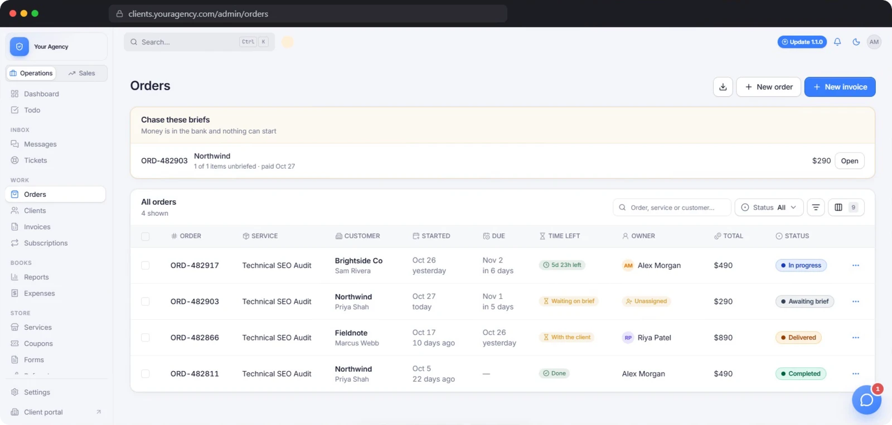
<p><b>Orders.</b> Every order shows whose move it is and how long is left. Paid orders still waiting on a brief are listed at the top, ready to chase in one action.</p>
</td>
<td width="50%" valign="top">
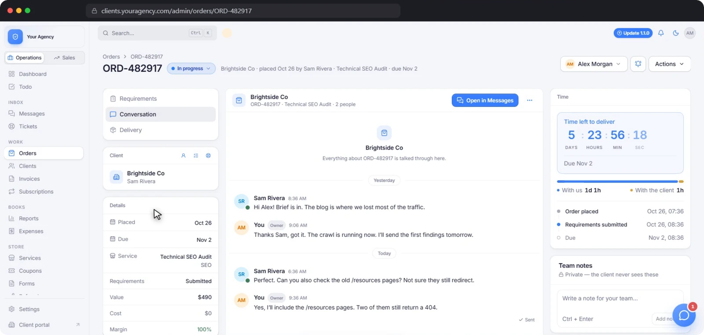
<p><b>The order page.</b> The brief, the conversation, the files and the delivery clock in one place, with time spent on your side and the client's.</p>
</td>
</tr>
<tr>
<td width="50%" valign="top">
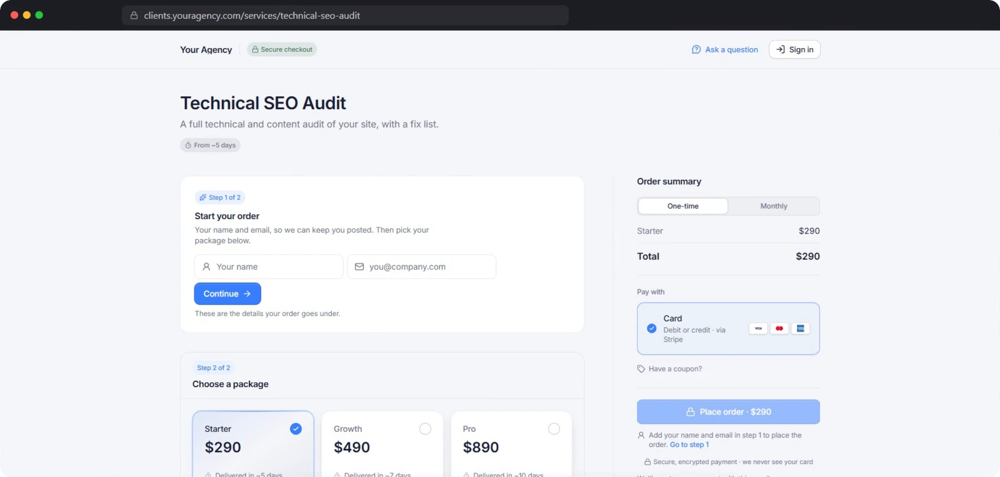
<p><b>Your service store.</b> Every service gets its own page on your domain. The buyer picks a package, pays, and the order exists only once payment is confirmed.</p>
</td>
<td width="50%" valign="top">
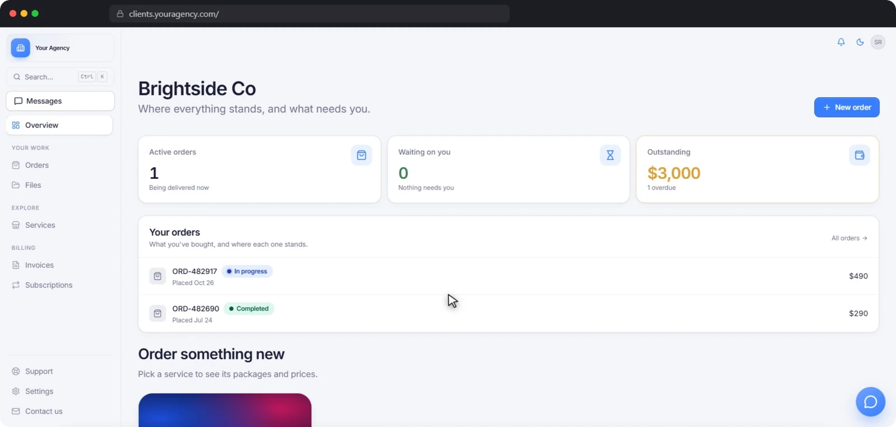
<p><b>The client portal.</b> What your clients see: their orders, what is waiting on them, what is outstanding, all under your name.</p>
</td>
</tr>
<tr>
<td width="50%" valign="top">
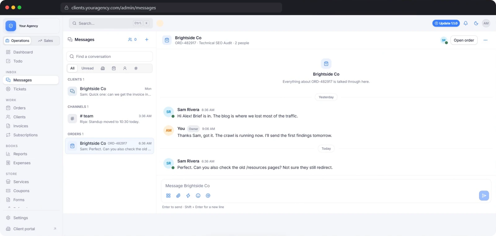
<p><b>Messages.</b> One conversation per client and per order, plus your team's own channels. Send a priced offer in the thread and the client accepts and pays it in one click.</p>
</td>
<td width="50%" valign="top">
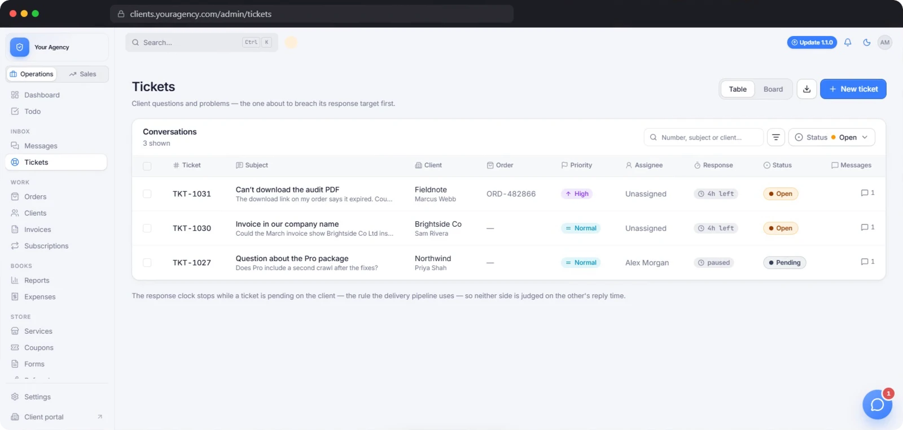
<p><b>Help desk.</b> A ticket queue with priority, assignee and first-response targets counted in your business hours only.</p>
</td>
</tr>
<tr>
<td width="50%" valign="top">
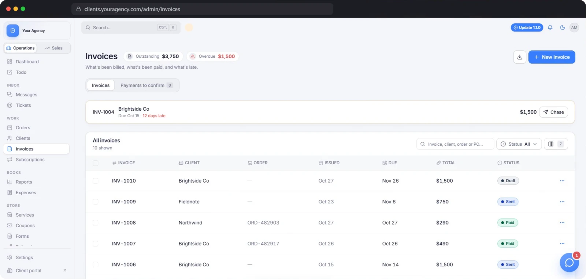
<p><b>Invoices.</b> Gapless numbering, pay links anyone can use, partial payments, credit notes, and a Chase button for anything overdue.</p>
</td>
<td width="50%" valign="top">
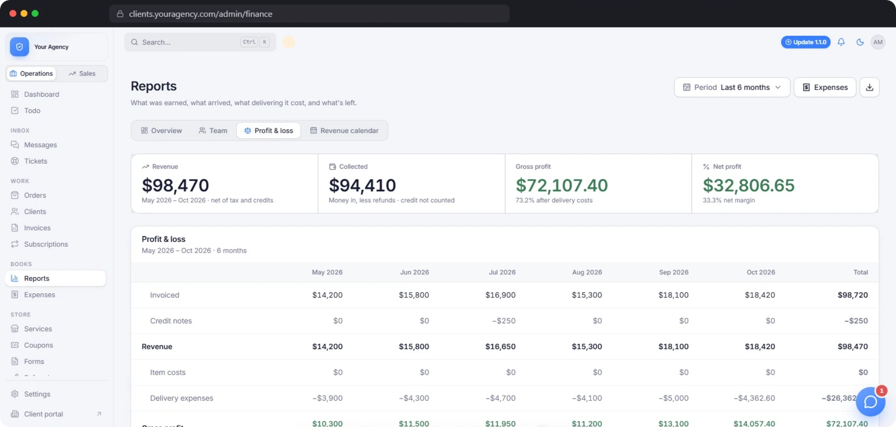
<p><b>Reports.</b> Profit and loss month by month: revenue, item costs, delivery expenses, gross and net profit. Every figure per currency.</p>
</td>
</tr>
</table>

<details>
<summary><b>More screens: task board, leads, subscriptions, branding, team and setup</b></summary>
<br>
<table>
<tr>
<td width="50%" valign="top">
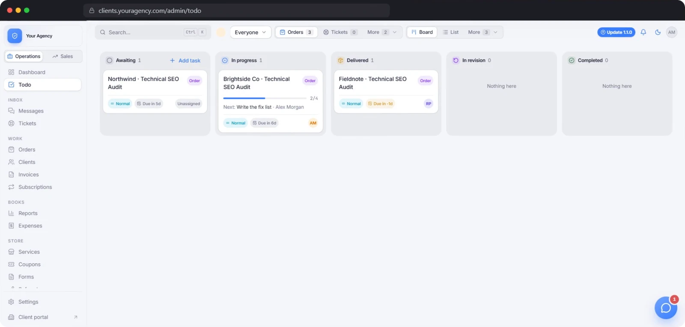
<p><b>Task board.</b> Orders, revisions, tickets and payments become cards on their own, with subtasks, owners and due dates.</p>
</td>
<td width="50%" valign="top">
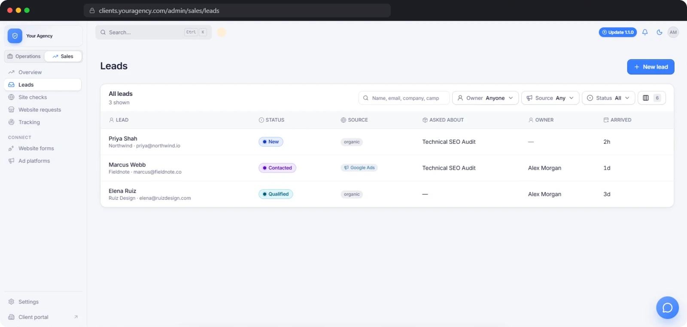
<p><b>Leads.</b> A pipeline with the source and value of every lead, fed straight from the forms on your website.</p>
</td>
</tr>
<tr>
<td width="50%" valign="top">
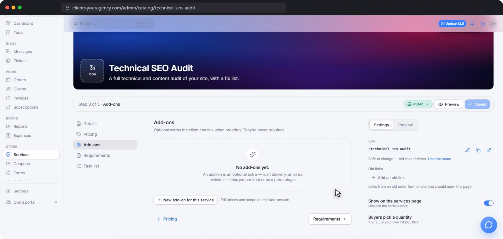
<p><b>Service editor.</b> Packages, add-ons, quantities and five pricing models, with a live preview while you edit.</p>
</td>
<td width="50%" valign="top">
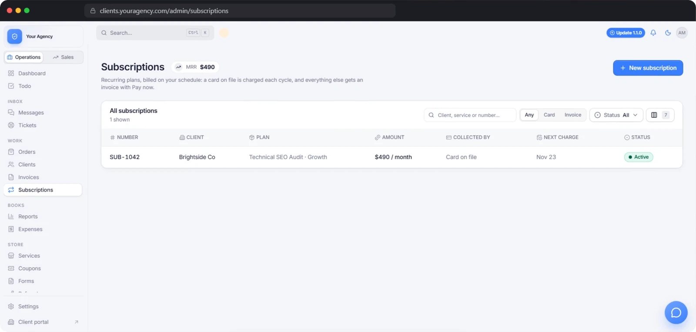
<p><b>Subscriptions.</b> Each renewal raises its own invoice and order, with card on file, retries and MRR.</p>
</td>
</tr>
<tr>
<td width="50%" valign="top">
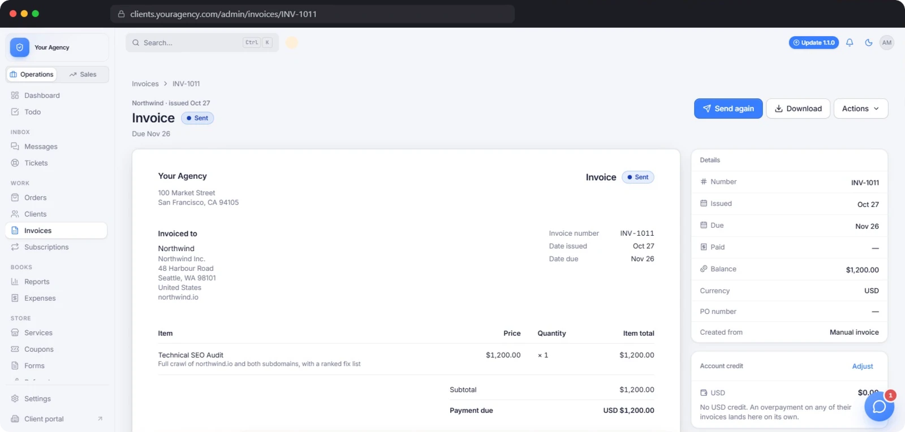
<p><b>An invoice.</b> Send it, copy the pay link, download the PDF, or record a payment by hand.</p>
</td>
<td width="50%" valign="top">
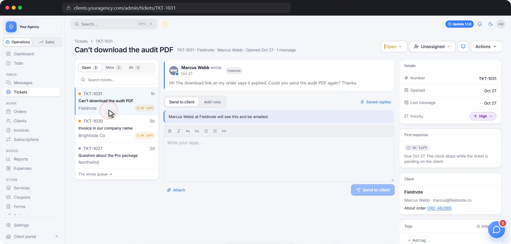
<p><b>A ticket.</b> Reply to the client or add an internal note. Pending pauses the response clock.</p>
</td>
</tr>
<tr>
<td width="50%" valign="top">
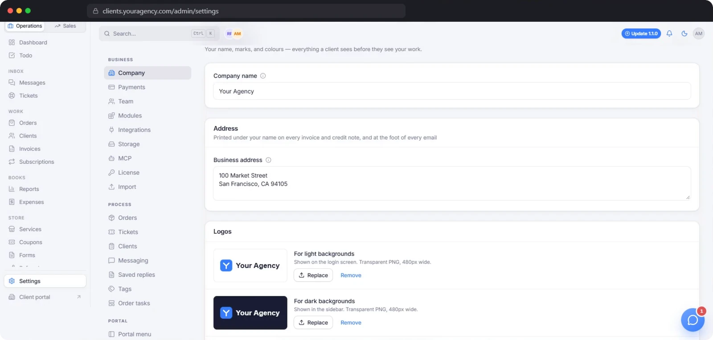
<p><b>Branding.</b> Your company name, address and logos for light and dark backgrounds, used on every surface a client sees.</p>
</td>
<td width="50%" valign="top">
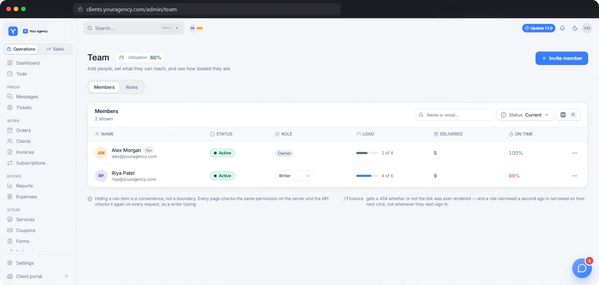
<p><b>Team.</b> Each member's role, workload and on-time delivery, with 122 permissions and six built-in roles.</p>
</td>
</tr>
<tr>
<td width="50%" valign="top">
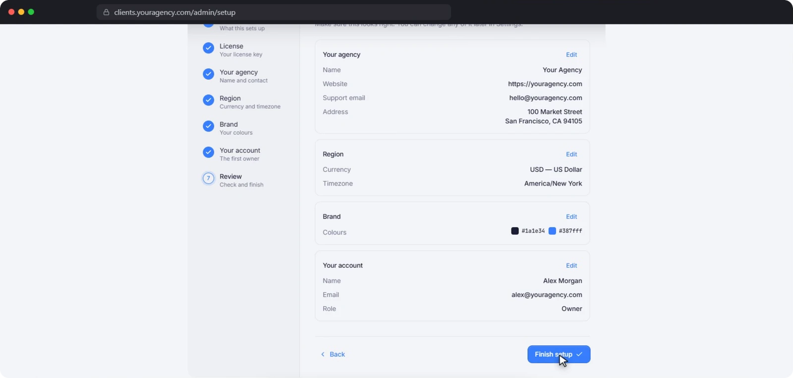
<p><b>Setup in the browser.</b> Seven short steps: license, agency, region, brand colours and the owner account.</p>
</td>
<td width="50%" valign="top">
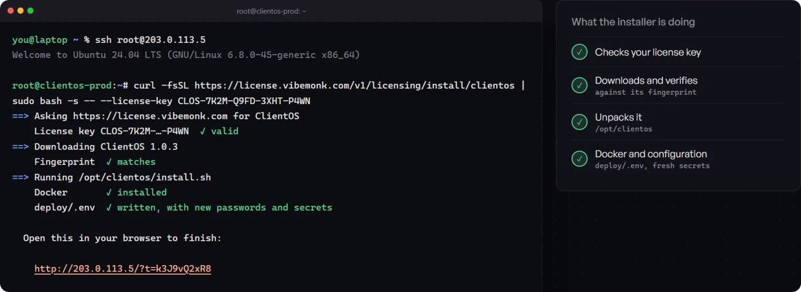
<p><b>The installer.</b> Checks your license, verifies every file by its fingerprint and sets up Docker for you.</p>
</td>
</tr>
</table>
</details>

## 🔁 How it works

From a stranger on your website to a paid, delivered and invoiced order, without a sales call in the middle.

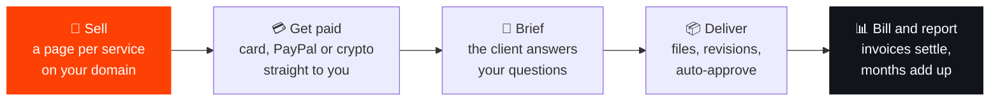

| Step | What happens |
|:--|:--|
| **01 · Sell** | Every service gets its own page on your domain. Visitors pick what they need and order on the spot, without a sales call. |
| **02 · Get paid** | Card, PayPal or crypto, straight to your accounts. The order exists only once the payment is confirmed. |
| **03 · Brief** | Right after paying, the client answers your questions in their portal. Work starts with everything you need. |
| **04 · Deliver** | Hand over the files on the order. The client approves or asks for a revision, and it approves itself if they go quiet. |
| **05 · Bill and report** | Invoices settle themselves when clients pay, and every month adds up in your reports. |

## 🧰 Everything in the box

Every package includes the full product. Click an area to expand it, or read its page on the
[site](https://huelab-byte.github.io/tryclientos/features/).

<details>
<summary><b>🛒 Service store and checkout</b>: sell productized services from your own domain</summary>

- **A sales page for every service**: draft, private or public, with a live preview while you edit.
- **Five pricing models**: tiered by quantity, fixed price, hourly, quote on request, and free. One-time or monthly.
- **The order exists only once payment is confirmed**: Stripe, PayPal, NOWPayments, CoinGate, your own BTCPay Server, manual wallet payments and account credit.
- **Requirements collected straight after paying**, so work starts with a complete brief.
- **Coupons, tax and a processing fee**, in 21 currencies, never silently converted.
- **Passwordless accounts**: buyers get a sign-in code by email. Cloudflare Turnstile keeps bots out.
- **Store analytics** from page view to paid. Item costs and margins stay private to your team.

→ [Store and checkout](https://huelab-byte.github.io/tryclientos/features/service-store-and-checkout/)
</details>

<details>
<summary><b>📦 Orders and delivery</b>: from brief to approval, always showing whose move it is</summary>

- **Statuses moved by the work**: awaiting brief, in progress, delivered, completed, plus custom statuses.
- **Delivery on a clock**: time with you, time with the client, and whether it was on time.
- **Revisions, approvals and auto-approve**: a quiet client stops holding your invoice open.
- **Chase every missing brief at once.**
- **Cancellations and refunds with a reason**, and a rating after each delivery.
- **A kanban task board that writes its own cards** from orders, revisions, tickets and payments.
- **Search, filters, bulk actions and CSV** on every list, plus a ⌘K command palette.

→ [Orders and delivery](https://huelab-byte.github.io/tryclientos/features/orders-and-delivery/)
</details>

<details>
<summary><b>🧾 Invoicing, subscriptions and finance</b>: invoices that settle themselves</summary>

- **Gapless numbering**: `INV-1001`, `INV-1002`… with credit notes in their own `CN-` series.
- **Pay links anyone can use**, with no client account needed.
- **Partial payments, refunds and credit notes.** Overpayments become credit, spent first next time.
- **Subscriptions that bill themselves**, with card on file, retries, MRR and client self-service.
- **Profit and loss month by month**, per currency.
- **Expenses with receipts, and margin by service.**
- **Delivery reports, a monthly report for every client, and CSV exports.**

→ [Invoicing and finance](https://huelab-byte.github.io/tryclientos/features/invoicing-and-payments/)
</details>

<details>
<summary><b>🎨 White-label</b>: a portal your clients read as yours</summary>

- **Your own domain**, such as `clients.youragency.com`, with HTTPS issued and renewed for you.
- **Two colours, repainted everywhere**: admin, portal, sign-in, emails and invoices.
- **Five logo slots** for light and dark backgrounds.
- **Rename the words clients read**, so "Orders" can read "Projects".
- **A portal menu and client dashboard you arrange**, with a welcome message and video.
- **Every email editable** with a live preview, sent from your own address.
- **Clients never see ClientOS**: not in the portal, not in the emails, not on the invoices.

→ [White-label](https://huelab-byte.github.io/tryclientos/features/white-label-client-portal/)
</details>

<details>
<summary><b>💬 Messages and help desk</b>: conversations next to the work</summary>

- **One thread per client and one per order**, plus team channels and direct messages.
- **Custom offers accepted in the thread**: line items, a discount, a total, paid in one click.
- **Presence, typing and waiting reminders.**
- **Saved replies, mentions, reactions and files.**
- **A help desk in the same portal**: statuses, priority, assignee, internal notes, merge and snooze.
- **First-response targets in your business hours.**
- **Email arrives as tickets.** Files are private, behind signed links that expire.

→ [Messages and help desk](https://huelab-byte.github.io/tryclientos/features/messages-and-support/)
</details>

<details>
<summary><b>📈 Leads and growth</b>: where did the money come from?</summary>

- **A lead pipeline** (new, contacted, qualified, proposal, won, lost) with the source and value of each lead.
- **Your website's forms send leads straight in**, protected against spam.
- **Follow-up emails that send themselves**: a thank-you, then days 2, 5 and 10.
- **Short links and a funnel to paid** for every source.
- **Conversions back to the ad platforms**: Meta Conversions API, and a Google Ads offline export.
- **A referral programme** with partner links, commissions and payouts.
- **A form builder with 17 field types**, rules and multi-page forms.

→ [Leads and growth](https://huelab-byte.github.io/tryclientos/features/leads-and-growth/)
</details>

<details>
<summary><b>🔐 Security and permissions</b>: built for agencies that hold sensitive client lists</summary>

- **Keys sealed with AES-256-GCM**, using a secret that exists only on your server.
- **A least-privilege database login**: the API refuses to start as a superuser or the table owner.
- **Private files behind expiring links**, 15 minutes by default.
- **122 permissions and six built-in roles**: Owner, Ops manager, Account manager, Writer, Outreach, Finance. Clients get per-company roles too.
- **2FA, passwordless codes and Google sign-in**, with 2FA enforceable for the whole team.
- **An audited "sign in as"**: read-only, 30 minutes, with the reason and every page logged.
- **HTTPS with HSTS, only ports 80 and 443 open**, every release file checked by SHA-256.

→ [Security and data](https://huelab-byte.github.io/tryclientos/features/security-and-data-ownership/)
</details>

<details>
<summary><b>🖥️ Self-hosting</b>: without the server headache</summary>

- **One domain, one A record**: portal at `/`, admin at `/admin`, API at `/v1`.
- **One command installs everything**, including Docker, PostgreSQL, file storage and HTTPS through Caddy and Let's Encrypt.
- **Finish in the browser** in seven short steps.
- **`clientos update`, `clientos rollback`, `clientos backup`**: one command each.
- **No cron to set up**: renewals, reminders and auto-approvals run inside the API.
- **Seven optional modules** (help desk, messages, coupons, subscriptions, forms, traffic tracking, referrals) you can switch off. The menus disappear and the data stays.

→ [Self-hosting](https://huelab-byte.github.io/tryclientos/features/self-hosting-and-install/)
</details>

## 🛡️ Your data stays on your server

> *"Hosted portals keep your clients, contracts and invoices on someone else's computer. ClientOS runs
> entirely on a server you rent and control."* (getclientos.com)

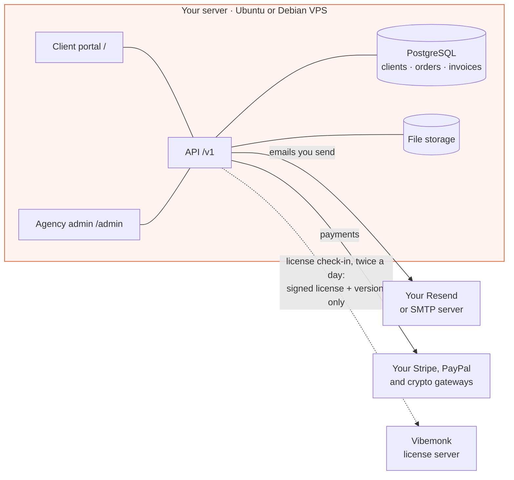

Those three arrows are **everything** that leaves your server. The license check-in carries no client,
order or invoice data. If it cannot get through, ClientOS keeps working for a seven-day grace period;
after that only the admin turns read-only, while the client portal, checkout and webhooks keep running
and nothing is deleted.

## ⚡ Install in one command


```bash
curl -fsSL https://license.vibemonk.com/v1/licensing/install/clientos | sudo bash -s -- --license-key CLOS-XXXX-XXXX-XXXX-XXXX
```

The installer checks your license, installs Docker if it is missing, generates every password, downloads
ClientOS with every file verified against its fingerprint, and turns on HTTPS. The docs put it at
**about 10 minutes**, then you finish in the browser.

| Resource | Minimum | Recommended |
|:--|:--|:--|
| Operating system | Ubuntu 22.04 or Debian 12 | Ubuntu 24.04 LTS |
| CPU | 1 vCPU | 2 vCPU |
| Memory | 2 GB | 4 GB |
| Free disk | 10 GB | 20 GB or more, SSD |
| Network | Public IPv4, ports 80 and 443 open | — |

Hetzner, DigitalOcean, Vultr, Linode and AWS Lightsail are all named in the
[installation docs](https://getclientos.com/docs/installation?utm_source=github&utm_medium=referral&utm_campaign=clientos_launch&utm_content=readme_install).

```bash
sudo clientos update     # back up, download, verify and restart
sudo clientos rollback   # go back one release
sudo clientos backup     # database, files and settings into one folder
```

> [!TIP]
> **Not technical?** On the **Premium** and **Custom** packages the ClientOS team installs it on your server
> for you, connects email and payments, and hands over a working portal.

> [!WARNING]
> Backups do not run on their own. `clientos backup` writes everything to a folder, but nothing runs it
> until you schedule it. The docs give a cron line for a daily 03:00 backup.

## 💰 Pricing: pay once, own it

<table>
<tr>
<th align="center" width="25%">Start-up</th>
<th align="center" width="25%">Standard<br><sub>⭐ most chosen</sub></th>
<th align="center" width="25%">Premium</th>
<th align="center" width="25%">Custom</th>
</tr>
<tr>
<td align="center"><h2>$490</h2><sub>one-time</sub></td>
<td align="center"><h2>$990</h2><sub>one-time</sub></td>
<td align="center"><h2>$1,790</h2><sub>one-time</sub></td>
<td align="center"><h2>Quoted</h2><sub>contact us</sub></td>
</tr>
<tr>
<td>3 months of updates</td>
<td>12 months of updates</td>
<td>2 years of updates</td>
<td><b>Lifetime updates</b></td>
</tr>
<tr>
<td>Standard support</td>
<td>Priority support</td>
<td>Priority support</td>
<td>Priority support</td>
</tr>
<tr>
<td>License for one agency</td>
<td>License for one agency</td>
<td><b>License for two agencies</b></td>
<td>Quoted for your agency</td>
</tr>
<tr>
<td>You install it, one command</td>
<td>You install it, one command</td>
<td><b>Installed on your server for you</b></td>
<td>Installed, with email and payments connected, plus an onboarding call</td>
</tr>
<tr>
<td>CSV import</td>
<td>CSV import</td>
<td>Data migration by the team</td>
<td>Custom features and integrations</td>
</tr>
<tr>
<td align="center"><a href="https://app.vibemonk.com/services/clientos?package=start-up"></a></td>
<td align="center"><a href="https://app.vibemonk.com/services/clientos?package=standard"></a></td>
<td align="center"><a href="https://app.vibemonk.com/services/clientos?package=premium"></a></td>
<td align="center"><a href="https://getclientos.com/contact?utm_source=github&utm_medium=referral&utm_campaign=clientos_launch&utm_content=readme_pricing_custom"></a></td>
</tr>
</table>

**In every package:** the full product (store, orders, messages, billing, tickets, reports) ·
**unlimited clients, staff and orders** · your domain and brand with no ClientOS name shown to clients ·
any Ubuntu or Debian server you choose · **keeps working when updates end** · 24/7 support.

Prices in US dollars, one license per domain. Each extra install is its own license.
→ [Full pricing](https://huelab-byte.github.io/tryclientos/pricing/) ·
[Buy on getclientos.com](https://getclientos.com/?utm_source=github&utm_medium=referral&utm_campaign=clientos_launch&utm_content=readme_pricing#pricing)

## ⚖️ ClientOS vs hosted portals

The difference is structural: **who owns the server**, and so whether you pay monthly or once. Competitor
prices below are from each vendor's own pricing page, checked on **29 October 2026**.

| | **ClientOS** | Wayfront (formerly SPP) | Zendo |
|:--|:--|:--|:--|
| **How you pay** | Once: [$490](https://app.vibemonk.com/services/clientos?package=start-up) / [$990](https://app.vibemonk.com/services/clientos?package=standard) / [$1,790](https://app.vibemonk.com/services/clientos?package=premium) | $99–$129/mo (Base) · $249–$299/mo (Pro) | $25–$29/mo (Core) · $79–$99/mo (Agency) |
| **Seats** | Unlimited staff | 5 on Base, 10 on Pro, then $18–$20 per seat a month | 1 included, then $8–$17 per user a month |
| **Where your client data lives** | Your own server | The vendor's servers | The vendor's servers |
| **Crypto payments** | NOWPayments, CoinGate, BTCPay, manual wallets | Not listed | Not listed (Stripe and bank transfer) |
| **Free trial** | Read-only demo, 3 days | 14 days, no card | 14 days of Pro, then a free plan |
| **Who runs the server** | You (or the team, on Premium and Custom) | Wayfront | Zendo |

Hosted tools win on some things, and we say so: no server to patch, interface languages other than
English, and integrations ClientOS does not list. Each comparison page has a section on **who should stay
where they are**:

[Wayfront (SPP) alternative](https://huelab-byte.github.io/tryclientos/wayfront-spp-alternative/) ·
[Zendo alternative](https://huelab-byte.github.io/tryclientos/zendo-alternative/) ·
[Agency Handy alternative](https://huelab-byte.github.io/tryclientos/agency-handy-alternative/) ·
[All comparisons](https://huelab-byte.github.io/tryclientos/alternatives/)

## 🏆 Case study: Dot Mirror

<table>
<tr>
<td width="130" valign="top" align="center">

</td>
<td valign="top">

> *"We sell white-label. Our partners trust us with their clients' names, and for years that list sat on
> someone else's servers, on a bill that went up every time we hired. ClientOS put the whole operation on
> our own server, under our own name, and the monthly bill simply went away. Partners see Dot Mirror and
> nothing else, and my team finally works out of one place we own."*
>
> **Shimanto Neer**, Founder, Dot Mirror

</td>
</tr>
</table>

<table>
<tr>
<td align="center"><h3>$0</h3><sub>monthly portal bill</sub></td>
<td align="center"><h3>$7,174</h3><sub>kept over three years vs<br>Wayfront Pro at list prices</sub></td>
<td align="center"><h3>100%</h3><sub>of client history moved</sub></td>
<td align="center"><h3>1 day</h3><sub>from install to live</sub></td>
</tr>
</table>

<sub>Figures are ClientOS's own published claims from the
<a href="https://getclientos.com/case-studies/dotmirror?utm_source=github&utm_medium=referral&utm_campaign=clientos_launch&utm_content=readme_casestudy">Dot Mirror case study</a>,
a white-label link building agency on the Premium package.</sub>

## 🧱 Built on

<p>
  
  
  
  
  
  
  
  
  
</p>

**Connects to:** Stripe · PayPal · NOWPayments · CoinGate · BTCPay Server · Resend · Cloudflare R2 ·
Cloudflare Turnstile · Google sign-in

> [!IMPORTANT]
> ClientOS is **self-hosted but not open source**. It ships as ready-built, SHA-256-verified Docker images
> with a one-command installer; the source code is not provided. This repository holds the marketing site
> and free resources, not the product.

## ❓ FAQ

<details>
<summary><b>What does self-hosted mean in practice?</b></summary>

ClientOS runs on a Linux server you rent and control, with its own PostgreSQL database, file storage and
HTTPS certificates. Email goes out through your Resend account or SMTP server, and payments go straight to
your gateway accounts. The only thing that leaves your server is a license check-in twice a day, carrying
your signed license and the version you run.
</details>

<details>
<summary><b>What happens when my updates run out?</b></summary>

Nothing stops. ClientOS keeps running on the version you have, and you can renew to get newer releases.
Lifetime updates come with the Custom package.
</details>

<details>
<summary><b>Can I move over from my current client portal?</b></summary>

On Start-up and Standard you bring your clients in yourself from a CSV file, with column mapping. On
Premium and Custom the ClientOS team moves your data for you, or builds a migration tool for it.
</details>

<details>
<summary><b>Is it really white-label?</b></summary>

It runs on your own domain with your logos, two brand colours, your client-facing words and your email
templates. The ClientOS name is not shown to clients anywhere.
</details>

<details>
<summary><b>Can the ClientOS team see my clients or their data?</b></summary>

No. ClientOS runs entirely on your server, and your database and files never leave it.
</details>

<details>
<summary><b>How many clients and staff can I have?</b></summary>

Every package states unlimited clients, staff and orders. The license is counted per domain, not per seat.
</details>

<details>
<summary><b>What languages does the portal support?</b></summary>

The interface is in English. You can rename the words your clients see, such as menu labels and headings,
from the settings.
</details>

<details>
<summary><b>Can I try it before buying?</b></summary>

Yes. The [instant demo](https://getclientos.com/demo?utm_source=github&utm_medium=referral&utm_campaign=clientos_launch&utm_content=readme_faq)
emails you a login to a live ClientOS with sample clients, orders and invoices: the full agency admin and
the client portal. It is read-only and works for 3 days. No call, no card.
</details>

<p><a href="https://huelab-byte.github.io/tryclientos/faq/">All 18 questions →</a></p>

## 🎁 Free agency resources in this repo

Useful whether or not you ever buy ClientOS. No sign-up and no email required.

<table>
<tr>
<td width="50%" valign="top">

### 📚 The curated list
Self-hosted portals, hosted white-label portals, and the onboarding, proposal, project management,
invoicing, scheduling and reporting tools around them.

→ [Client portal software](https://huelab-byte.github.io/tryclientos/client-portal-software/)

</td>
<td width="50%" valign="top">

### 📄 Four free templates
Vendor-neutral. They work with any client portal, or with none.

- [Client onboarding checklist](https://huelab-byte.github.io/tryclientos/templates/client-onboarding-checklist/) · [`.md`](templates/client-onboarding-checklist.md)
- [Project kickoff questionnaire](https://huelab-byte.github.io/tryclientos/templates/project-kickoff-questionnaire/) · [`.md`](templates/project-kickoff-questionnaire.md)
- [Agency SOP: client communication](https://huelab-byte.github.io/tryclientos/templates/agency-sop-client-communication/) · [`.md`](templates/sop-client-communication.md)
- [Monthly client report outline](https://huelab-byte.github.io/tryclientos/templates/monthly-client-report/) · [`.md`](templates/monthly-client-report.md)

</td>
</tr>
</table>

Want a tool added to the list? See [CONTRIBUTING.md](CONTRIBUTING.md): one pull request per addition, one
neutral sentence, and **disclose any affiliation**, the same standard the ClientOS entry is held to.

## 🔎 Disclosure

**This repository is maintained by the ClientOS team**, and ClientOS is our own product. We are not a
neutral party and the site does not pretend to be one. What it does instead is show its working:

- Every **ClientOS** claim comes from [getclientos.com](https://getclientos.com) or its documentation. The
  full audit, with the page each fact was read from, is in **[AUDIT.md](AUDIT.md)**: 28 pages read on
  29 October 2026.
- Every **competitor** claim comes from that competitor's own public pages, carries the date it was
  checked, and links to the source. Nothing comes from a review site or a listicle.
- Where something could not be verified, it is **not claimed** and is listed in
  **[UNVERIFIED.md](UNVERIFIED.md)** instead. That includes Agency Handy, whose site refused connections
  from our network, and every gap in ClientOS's own published material: no renewal price, no refund
  policy, no customer count, no rating.
- There is **no `aggregateRating` or `review` in any structured data on the site**, because
  getclientos.com publishes no rating. `scripts/check-links.mjs` fails the build if one ever appears.
- Every comparison page names the agencies who should **stay where they are**.
- Nothing here is a paid placement, and inclusion in the list is not an endorsement.

Found something wrong or out of date? [Open an issue](https://github.com/huelab-byte/tryclientos/issues).
Corrections are the point.

## 🛠️ About this repository

<details>
<summary><b>Project structure, local setup, build scripts and deploy</b></summary>

### What is in here

| Path | What it is |
|---|---|
| `src/pages/` | The site's routes: one `.astro` file per page, plus three dynamic routes |
| `src/content/` | **Every fact the site states, as data.** `site.ts` (ClientOS), `alternatives.ts` (comparisons), `faq.ts`, `list.ts` (the curated list), `templates.ts` |
| `src/components/`, `src/layouts/` | Header, footer, CTA, FAQ, logo, the base layout with all SEO head tags |
| `src/lib/schema.ts` | JSON-LD builders: `SoftwareApplication`, `FAQPage`, `BreadcrumbList`, `ItemList`, `WebPage` |
| `templates/` | The four free agency templates as markdown, **generated** from `src/content/templates.ts` |
| `public/og/` | One branded 1200×630 social card per page, **generated** by `pnpm og` |
| `src/assets/fonts/` | General Sans, the ClientOS display face, bundled by Vite under the right base |
| `public/screens/`, `public/video/` | Product screenshots and the showreel, used by both the site and this README |
| `scripts/` | The three build scripts (below) |
| `AUDIT.md` | The full source audit of getclientos.com and the two reachable competitors |
| `UNVERIFIED.md` | What could not be checked, and is therefore not claimed |

Pages are generated from the files in `src/content/`, so a number appears in exactly one place. Changing
the ClientOS Standard price, for example, is one edit in `src/content/site.ts` and it updates the pricing
page, the comparison tables and the JSON-LD `offers` together.

### Setup

Requires **Node 24+** (the build scripts import TypeScript data modules directly) and **pnpm 11+**.

```bash
pnpm install     # install dependencies
pnpm dev         # http://localhost:4321/tryclientos/
pnpm build       # static site into dist/
pnpm preview     # serve dist/ locally
pnpm check       # astro check: TypeScript across .astro and .ts
pnpm og          # re-render the social cards into public/og/
```

### The scripts

- **`scripts/build-downloads.mjs`** runs automatically as `prebuild`. It writes the four templates from
  `src/content/templates.ts` into both `templates/` (browsable on GitHub) and `public/downloads/` (what
  the site serves), so the rendered page, the repo file and the download can never disagree.
- **`scripts/generate-og.mjs`** renders one 1200×630 PNG per page with
  [resvg](https://github.com/yisibl/resvg-js), using the real ClientOS mark, the brand colours `#fd4105`
  and `#12141c`, and General Sans. The PNGs are committed, so a normal build never needs the native
  renderer. Run it after adding a page or changing a headline.
- **`scripts/check-links.mjs`** is a post-build check over `dist/`: every internal link resolves, every
  page has a canonical, a description, an `<h1>`, a title under 70 characters and an `og:image` that
  exists, and no page contains a rating claim.

```bash
pnpm build && node scripts/check-links.mjs
```

### Deploy

The same code deploys to two hosts. [`deploy-target.mjs`](deploy-target.mjs) decides the origin and
the base path once, and the Astro config and the link checker both read it:

| Host | URL | Base | How it is picked |
|---|---|---|---|
| GitHub Pages | `https://huelab-byte.github.io/tryclientos/` | `/tryclientos` | the default |
| Vercel | `https://<project>.vercel.app/` | `/` | Vercel sets `VERCEL=1` during its build |

Two optional environment variables override either: `SITE_URL` (the origin, e.g. a custom domain) and
`BASE_PATH` (e.g. `/`). `SITE_URL` is also what canonicals and the sitemap point at, so set it to the
same host on both deployments to tell search engines which copy is the original.

**GitHub Pages.** GitHub Actions builds and publishes on every push to `main`
([`.github/workflows/deploy.yml`](.github/workflows/deploy.yml)). One-time setup: in the repository,
go to **Settings → Pages** and set **Source** to **GitHub Actions**. Without that, the workflow builds
and then fails at the deploy step with `HttpError: Not Found`.

**Vercel.** Import the repository; the Astro preset needs no changes (build `pnpm build`, output
`dist`). Nothing else is required.

</details>

## 📜 License

Content in this repository (the list, the templates, the site copy) is released under
[CC0 1.0](LICENSE). Use it, change it, republish it.

**Not** covered by that waiver:

- **The ClientOS name, logo, product screenshots and showreel**, which belong to Vibemonk.
- **The Dot Mirror quote and portrait**, reproduced from the published case study.
- **General Sans** in `src/assets/fonts/` and `scripts/fonts/`, from
  [Fontshare](https://www.fontshare.com/fonts/general-sans), under its own license.

Competitor names (Wayfront, Service Provider Pro, Zendo, Agency Handy and every tool in the list) are
trademarks of their respective owners. This repository is not affiliated with or endorsed by any of them.

<br>

<div align="center">

<a href="https://getclientos.com/demo?utm_source=github&utm_medium=referral&utm_campaign=clientos_launch&utm_content=readme_footer"></a>

<sub><b>Your client portal. Your server. Your data.</b><br>
<a href="https://getclientos.com">getclientos.com</a> · made by <a href="https://vibemonk.com">Vibemonk</a></sub>

</div>
